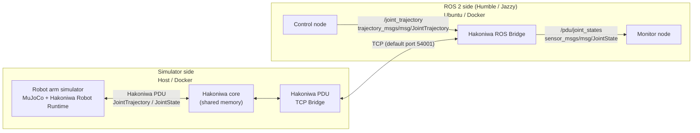

# hakoniwa-robot-arm

English | [日本語](README.ja.md)

`hakoniwa-robot-arm` runs MuJoCo simulations of robot arms on Windows, macOS and Ubuntu, and lets you control them from ROS 2 without real hardware. On macOS and Windows, ROS 2 runs in Docker.

It is built on [Hakoniwa](https://github.com/hakoniwalab) and the [Hakoniwa Robot Runtime](https://github.com/hakoniwalab/hakoniwa-robot-runtime). Each robot starts from its ROS robot model (URDF / Xacro), which is converted to MuJoCo (MJCF). You command the joints and read their state either directly through Hakoniwa or from ROS 2 with `JointTrajectory` and `JointState`.

An arbitrary URDF does not work as is. Each robot needs its own Recipe: where the model comes from, how it is normalized, and its actuator and controller settings. The robots below are the ones this repository provides.

> The detailed procedures and design documents under [`docs/`](docs/README.md) are written in Japanese. This page gives the overview and points to the right procedure for your environment.

## Supported robots

| Robot | ID | Status |
| --- | --- | --- |
| DOBOT Nova5 | `nova5` | Verified on Ubuntu 24.04 native (host-ros2), Windows 11 native (host-standalone, and host+Docker with ROS 2 Jazzy), macOS (host+Docker with ROS 2 Jazzy) and Linux arm64 (docker-only, ROS 2 Humble / Jazzy). |
| FAIRINO FR5 | `fr5` | Sources and tools are published. Verification is in progress. |
| SO-101 follower | `so101` | Sources and tools are published. Verification is in progress. |
| MathScavator9000 Excavator | `excavator` | Headless driving verified on macOS, WSL2 Ubuntu 24.04 and Windows 11 native. The MuJoCo Viewer and other environments are not verified yet; digging is experimental. See the [Recipe](recipes/excavator/README.md). |

Only Nova5 has been verified end to end, including ROS 2. The common procedures use Nova5 as the example; [Supported robots](docs/reference/robots.md) shows how to apply them to the other robots.

## What you can do

- Convert the URDF / Xacro model of a supported robot to MuJoCo (MJCF)
- Run a physics simulation of the robot arm in MuJoCo
- Control the joints through the Hakoniwa Robot Runtime
- Send joint trajectories from ROS 2 (`trajectory_msgs/msg/JointTrajectory`)
- Read joint states in ROS 2 (`sensor_msgs/msg/JointState`)
- Run the ROS 2 side in Docker
- Watch the simulation in the MuJoCo Viewer on the host, or run it headless

## Execution modes

The simulator and ROS 2 are connected over TCP, so they can run in different places. Choose one mode. In the configurations verified by this project, ROS 2 runs natively on Ubuntu and in Docker on macOS and Windows.

| Mode | Host OS | Simulator | ROS 2 | Procedure |
| --- | --- | --- | --- | --- |
| host-standalone | macOS / Ubuntu | Host | Not used | [setup](docs/procedures/host-standalone/setup.md) → [build](docs/procedures/host-standalone/build.md) → [operation](docs/procedures/host-standalone/operation.md) |
| windows-host-standalone | Windows 11 | Host (native) | Not used | [setup](docs/procedures/windows-host-standalone/setup.md) → [build](docs/procedures/windows-host-standalone/build.md) → [operation](docs/procedures/windows-host-standalone/operation.md) |
| host-ros2 | Ubuntu 24.04 | Host | Host (native) | [setup](docs/procedures/host-ros2/setup.md) → [build](docs/procedures/host-ros2/build.md) → [operation](docs/procedures/host-ros2/operation.md) |
| host+docker | macOS | Host | Docker container | [setup](docs/procedures/host-docker/setup.md) → [build](docs/procedures/host-docker/build.md) → [operation](docs/procedures/host-docker/operation.md) |
| windows-host-docker | Windows 11 | Host (native) | Docker Desktop | [setup](docs/procedures/windows-host-docker/setup.md) → [build](docs/procedures/windows-host-docker/build.md) → [operation](docs/procedures/windows-host-docker/operation.md) |
| docker-only | Linux / macOS | Same container as ROS 2 | Same container | [setup](docs/procedures/docker-only/setup.md) → [build](docs/procedures/docker-only/build.md) → [operation](docs/procedures/docker-only/operation.md) |

Notes:

- The ROS 2 distributions are Humble and Jazzy. The Windows host+Docker mode is verified with Jazzy.
- docker-only needs only Git and Docker on the host. On macOS Docker Desktop it runs headless; on a native Linux host the Viewer is available.
- The excavator has its own procedures: [host-standalone (macOS / Ubuntu 24.04 / WSL2)](docs/procedures/excavator/host-standalone/setup.md) and [windows-host-standalone](docs/procedures/excavator/windows-host-standalone/setup.md).
- [Choosing a mode](docs/procedures/setup.md) compares the modes in more detail.

## Quick start

1. Install the prerequisites for your mode:
   - Git (all modes)
   - CPython 3.12, available as `python3.12`, plus CMake and a C/C++ toolchain (modes that build on the host). On macOS this means the Xcode Command Line Tools.
   - Docker (host+docker, windows-host-docker, docker-only)
2. Create an empty directory and clone these two repositories side by side:

   ```bash
   mkdir -p hakoniwa-robot-arm-workspace
   cd hakoniwa-robot-arm-workspace
   git clone https://github.com/hakoniwalab/hakoniwa-business-pack.git
   git clone https://github.com/teras-project/hakoniwa-robot-arm.git
   ```

   The other Hakoniwa repositories and the robot models are fetched later by the Recipe steps, at the revisions recorded in the Recipes.
3. Follow setup → build → operation for your mode in the [Execution modes](#execution-modes) table.

## How it works



- ROS topics end on the ROS 2 side. On the simulator side the same data are Hakoniwa PDUs in the Hakoniwa core's shared memory.
- The Hakoniwa Robot Runtime assembles each robot from definition files: the asset manifest, the MuJoCo model, the PDU definitions and the actuator, controller and sensor settings. This repository owns those files for each robot; their meaning and rules are defined in [hakoniwa-robot-runtime](https://github.com/hakoniwalab/hakoniwa-robot-runtime/blob/main/docs/configuration.md).
- [hakoniwa-business-pack](https://github.com/hakoniwalab/hakoniwa-business-pack) provides the Workspace, the Foundation (the shared Hakoniwa runtime) and the Recipe tools that fetch dependencies and build everything under one work directory.

## Repository layout

| Path | Contents |
| --- | --- |
| `apps/` | Simulator applications on the shared Robot Runtime |
| `recipes/<robot>/` | Per-robot manifests, PDU, control and Forge settings |
| `recipes/ros2/` | Recipe for the ROS 2 TCP bridge |
| `ros2_packages/` | Sample ROS 2 nodes built with colcon |
| `sources/models/` | Where each upstream model comes from and how it is normalized. The models themselves are not included. |
| `tools/` | Forge, Recipe, environment and control tools |
| `docker/` | Containers for ROS 2 Humble / Jazzy |
| `docs/` | Procedures, design documents, references and license records (Japanese) |

## License and robot models

- The code, configuration, tools and documents of this repository are licensed under the [Apache License 2.0](LICENSE), except for third-party material marked otherwise.
- Upstream robot models (URDF, Xacro, MJCF, meshes, CAD, textures) and the files Forge generates from them are not included or redistributed here. You fetch them from pinned revisions and generate them under `$HAKONIWA_WORK_DIR/model-forge/`.
- The Apache License of this repository does not apply to third-party models or their derivatives. Check each model's sources, pinned revision and redistribution notes in [Robot model licenses](docs/license/robot-models.md), and the dependencies in [Dependency licenses](docs/license/dependencies.md).

## Project

This repository is maintained in [teras-project/hakoniwa-robot-arm](https://github.com/teras-project/hakoniwa-robot-arm). Hakoniwa Lab contributes through pull requests from its fork, [hakoniwalab/hakoniwa-robot-arm](https://github.com/hakoniwalab/hakoniwa-robot-arm).

## More information

- [Usage guide](docs/README.md) (Japanese)
- [Supported robots](docs/reference/robots.md) (Japanese)
- [Nova5 Recipe](recipes/nova5/nova5-joint-trajectory-control.yaml)
- [Docker settings](docker/env.bash)
